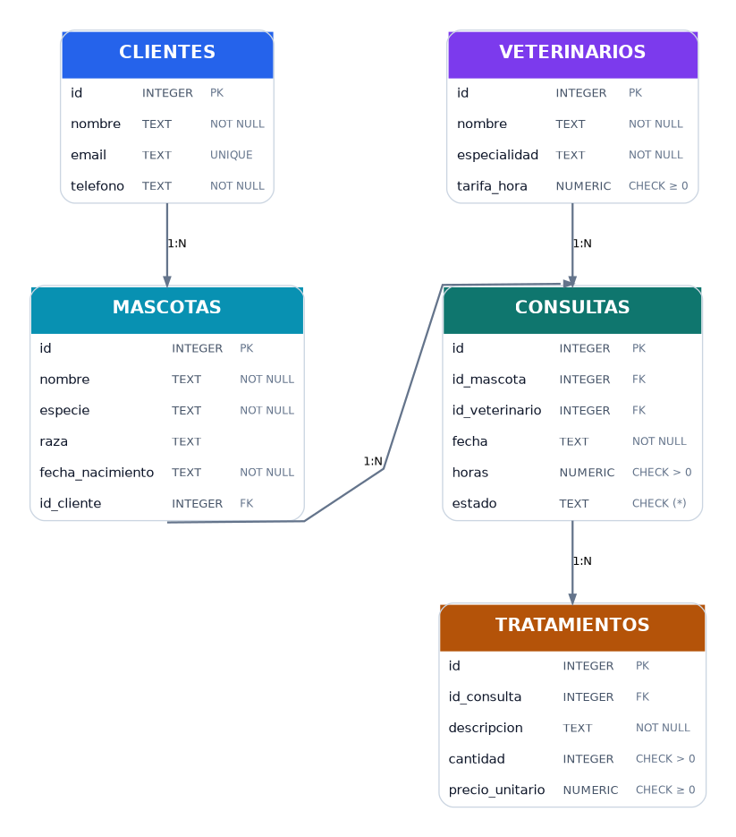

# Clínica veterinaria

Proyecto Java 21 / Maven / JDBC / SQLite / JUnit 5. Implementación completa de **33 métodos**: 25 CRUD y 8 específicos. 


## Diagrama visual de la base de datos



El diagrama representa los cinco objetos SQLite, sus columnas, claves primarias (`PK`) y foráneas (`FK`) y las relaciones 1:N. En `schema.sql` figuran las restricciones completas; por ejemplo, los estados posibles de `consultas` son `PROGRAMADA`, `EN_CURSO` y `FINALIZADA`.

## Requisitos y ejecución

- JDK 21 y Maven 3.9+.
- Desde el directorio raíz: `mvn test`.
- Dependencias externas: `org.xerial:sqlite-jdbc:3.46.1.0` y `org.junit.jupiter:junit-jupiter:5.11.4`.
- Ejemplo: `String url = "jdbc:sqlite:datos/clinica.sqlite3"; ClienteDao dao = new ClienteDao(url); dao.listar();`
- El archivo SQLite **debe existir** antes de crear la conexión. La ruta relativa se resuelve desde el directorio de trabajo actual.

## Contratos

- `listar()` devuelve lista (vacía cuando no hay filas), `buscarPorId()` devuelve `Optional`.
- `insertar()` devuelve el identificador generado por SQLite.
- `actualizar()` y `eliminar()` devuelven el número de filas afectadas.
- Los fallos SQL se convierten en `DaoException` preservando la causa; nulos requeridos y restricciones de integridad generan error.
- Los importes se manipulan en Java con `BigDecimal`, y los tiempos y fechas se almacenan como texto ISO. SQLite presenta afinidad NUMERIC, por lo que es apropiado para este ejercicio, no necesariamente para una aplicación de facturación de producción.
- No hay borrado en cascada: primero se borran dependencias si resulta necesario.
- `calcularCosteTratamientos()` devuelve cero si la consulta no tiene tratamientos. No incluye honorarios veterinarios; solo materiales/tratamientos.

## Diseño y estructura

- `modelo`: clases mutables con constructores, getters y setters `Cliente`, `Mascota`, `Veterinario`, `Consulta`, `Tratamiento`.
- `dao`: cada interfaz `IClienteDao`, `IMascotaDao`, `IVeterinarioDao`, `IConsultaDao`, `ITratamientoDao` declara las cinco operaciones CRUD y sus operaciones específicas, sin heredar de otra interfaz; `AbstractDao<T>` centraliza CRUD, mapeo y consultas parametrizadas; los DAO concretos definen mapeos y filtros.
- `infra`: `ConexionBD` ***ya no existe. Depende de tí como programador saber como y cuando se crea la conexión sobre la BBDD***.
- `datos`: SQLite de ejemplo y copia para pruebas manuales. Las pruebas JUnit incluidas usan bases SQLite temporales independientes, por lo que no alteran estos archivos.
- `src/main/resources/schema.sql`: esquema reproducible; `consultas.sql`: consultas planteadas. Práctica para tener agilidad.

## Evaluación orientativa

***La solución resuelve las fases de consultas, implementación DAO, centralización de conexión, y pruebas. La refactorización se ha dejado abierta a las capacidades de cada alumno. Es decir, en primer lugar resuelve, y después comienza a refactorizar el código.***

## Nota de validación

Se han comprobado la estructura y las sentencias SQL con SQLite. El entorno de generación no dispone de Maven ni de las dependencias Java locales; por tanto, la ejecución real de `mvn clean test` requiere un equipo con Maven y acceso a las dependencias.

## Pruebas automatizadas: 90 casos JUnit 5

Los ficheros `*DaoTest.java` y `IntegracionDaoTest.java` incluyen **90 métodos anotados con `@Test`**, de los que 10 comprueban flujos integrados y restricciones, y otros 80 cubren de forma individual clientes, mascotas, veterinarios, consultas y tratamientos (**16 por entidad**). Cada método utiliza su propia base SQLite temporal creada en `@BeforeEach` y borrada en `@AfterEach`.

```bash
mvn clean test
```

Para ver el informe de ejecución, consulta `target/surefire-reports/`.

## Interfaces de acceso a datos

- `IClienteDao`: `listar`, `buscarPorId`, `insertar`, `actualizar`, `eliminar`.
- `IMascotaDao`: las cinco operaciones CRUD más `buscarPorCliente` y `listarPorEspecie`.
- `IVeterinarioDao`: las cinco operaciones CRUD más `buscarPorEspecialidad`.
- `IConsultaDao`: las cinco operaciones CRUD más `buscarPorMascota`, `buscarPorVeterinario` y `listarProgramadas`.
- `ITratamientoDao`: las cinco operaciones CRUD más `listarPorConsulta` y `calcularCosteTratamientos`.

Ejemplo de programación contra una interfaz:

```java
IClienteDao dao = new ClienteDao("jdbc:sqlite:datos/clinica.sqlite3");
var clientes = dao.listar();
```

La cadena de datos **"jdbc:sqlite:datos/clinica.sqlite3"** será la url, y se debe de verificar que existe. 

> **Recueda**: Sabes como. Utiliza Path.of, File/Files. 

## Orden recomendado de construcción (itinerario que te recomiendo seguir)

1. **Leer el esquema y los modelos** (`schema.sql` y las cinco clases modelo). Identificar claves primarias, foráneas, columnas obligatorias y los estados permitidos. Antes de programar, ejecutar las consultas SQL de ejemplo para comprender los datos.
2. **Crear `ConexionBD` si lo consideras necesario y verificar una conexión** a un archivo SQLite existente, activando `PRAGMA foreign_keys = ON`. Probar una consulta simple con JDBC y cerrar todos los recursos mediante `try-with-resources`.

```java
if (url == null || !url.startsWith("jdbc:sqlite:")) throw new IllegalArgumentException("URL SQLite no válida");
  String ruta = url.substring("jdbc:sqlite:".length());
  if (!ruta.equals(":memory:") && !ruta.startsWith("file:") && !Files.isRegularFile(Path.of(ruta)))
   throw new IllegalArgumentException("La base de datos no existe: " + ruta);
  Connection cn = DriverManager.getConnection(url);
  try (Statement st = cn.createStatement()) { st.execute("PRAGMA foreign_keys = ON"); }
  catch (SQLException e) { cn.close(); throw e; }
  return cn;
```

> **Nota**: *Esta es la respuesta a lo planteado en el ejercicio anterior*.

3. **Implementar primero `ClienteDao.insertar()`**, comprobando que genera un identificador válido. Continuar con `buscarPorId()` para verificar lo insertado, `listar()` (equivalente a `buscarTodos` o `findAll`), `actualizar()` y, finalmente, `eliminar()`. Comprobar cada operación antes de seguir.
    > Recuerda: Ejecuta los test de este dao.
4. **Completar `VeterinarioDao`**, al no depender de otras tablas: `insertar` → `buscarPorId` → `listar` → `actualizar` → `eliminar`; después implementar `buscarPorEspecialidad`.
    > Recuerda: Ejecuta los test de este dao.
5. **Completar `MascotaDao`**, que depende de `ClienteDao`; crear primero un cliente y luego la mascota. Implementar CRUD en el mismo orden y a continuación `buscarPorCliente` y `listarPorEspecie`. Verificar las restricciones de clave foránea.
    > Recuerda: Ejecuta los test de este dao.
6. **Completar `ConsultaDao`**, que necesita una mascota y un veterinario existentes. Implementar CRUD y después `buscarPorMascota`, `buscarPorVeterinario` y `listarProgramadas`. Probar estados válidos e inválidos.
    > Recuerda: Ejecuta los test de este dao.
7. **Completar `TratamientoDao`**, que necesita una consulta. Implementar CRUD, `listarPorConsulta` y `calcularCosteTratamientos`; comprobar el total de varias líneas y el caso sin tratamientos.
    > Recuerda: Ejecuta los test de este dao.
8. **Ejecutar las pruebas de cada DAO tras cada paso** y finalmente las pruebas de integración y restricciones. Revisar el informe Surefire, resolver errores y ejecutar `mvn clean test`.
    > Recuerda: Ejecuta los test de este dao.
9. **Extraer la repetición a `AbstractDao<T>`**: conexión, consultas parametrizadas, CRUD común y contrato de conversión `ResultSet` → entidad. `ClienteDao` proporciona su SQL específico y su conversor; la abstracción no debe conocer los nombres de columnas de otros modelos.
    > Recuerda: Esto sólo es necesario si te sientes capaz.

**Orden dentro de cada DAO:** `insertar` → `buscarPorId` → `listar` (*buscarTodos/findAll*) → `actualizar` → `eliminar` → filtros y cálculos especializados. Este orden facilita construir una fila, recuperarla, verificar cambios y comprobar finalmente su borrado.

**Orden de las entidades por dependencias:** `Cliente` → `Veterinario` → `Mascota` → `Consulta` → `Tratamiento`. Al borrar datos con relaciones, seguir el **orden inverso** (primero tratamientos, después consultas y mascotas, etc.).

## Organización

| Fichero | Número de pruebas | Cobertura |
|---|---:|---|
| `ClienteDaoTest.java` | 16 | CRUD, buscarTodos, email duplicado, uso de interfaz |
| `MascotaDaoTest.java` | 16 | CRUD, buscarTodos, filtros y propietario inexistente |
| `VeterinarioDaoTest.java` | 16 | CRUD, buscarTodos, especialidad, tarifas |
| `ConsultaDaoTest.java` | 16 | CRUD, buscarTodos, filtros, estados |
| `TratamientoDaoTest.java` | 16 | CRUD, buscarTodos, filtros y totales |
| `IntegracionDaoTest.java` | 10 | Flujos combinados, integridad, errores y restricciones |
| **Total** | **90** | |

`BaseDaoTest.java` contiene únicamente la preparación y limpieza comunes (`@BeforeEach` / `@AfterEach`); no añade casos. Cada test lleva un comentario Javadoc que explica el escenario. Los nombres de las pruebas siguen la convención **lowerCamelCase descriptivo con sufijo `Test`** (por ejemplo, `buscarTodosDevuelveListaVaciaTest()` o `insertarRetornaIdTest()`). Estos nombres describen la comprobación del método real `listar()`: **no se cambia la API** para mantener la compatibilidad con el proyecto.

Para ejecutar solo una clase de pruebas: `mvn -Dtest=ClienteDaoTest test`. Para ejecutar una única prueba: `mvn -Dtest=ClienteDaoTest#buscarTodosDevuelveListaVaciaTest test`. Para ejecutar la suite: `mvn clean test`.

