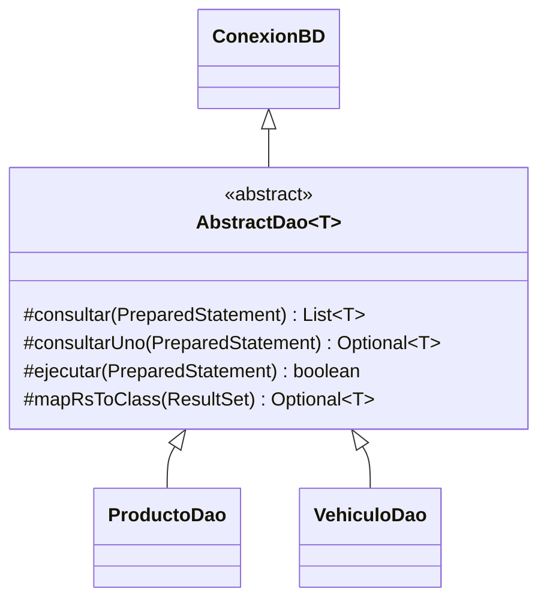

# Ejercicio para el alumnado: DAO genérico y PreparedStatement

## Situación y objetivo

Una aplicación gestiona **productos** y **vehículos** en SQLite. El código JDBC debe mantenerse sin duplicación, con una clase abstracta genérica para ejecutar consultas y DAO específicos para definir el SQL, los parámetros y el mapeo de cada entidad.

**Partimos de `ProductoDao.listar()` completamente implementado**, junto con `ProductoDao.mapRsToClass()`. Tu trabajo es completar los `TODO` de `ProductoDao` y `VehiculoDao`, siguiendo exactamente el patrón del ejemplo.

## Herencia obligatoria



- **`ConexionBD`**: devuelve la `Connection` abierta; **no** debe usar `try (Connection ... )` dentro de `obtenerConexion()`.
- **`AbstractDao<T>`**: ejecuta el `PreparedStatement`, procesa el `ResultSet` y captura excepciones. No construye SQL específico.
- **`ProductoDao` / `VehiculoDao`**: abren `Connection`, crean `PreparedStatement`, asignan parámetros y cierran ambos mediante `try-with-resources`.
- **`T`** identifica el tipo de entidad (`Producto` o `Vehiculo`). No hace falta un parámetro genérico `ID` porque cada DAO realiza sus búsquedas por clave.

## Método de ejemplo: ProductoDao.listar()

```java
public List<Producto> listar() {
    String sql = "SELECT id,nombre,precio FROM Productos ORDER BY id";
    try (Connection con = obtenerConexion();
         PreparedStatement ps = con.prepareStatement(sql)) {
        return consultar(ps);
    } catch (SQLException | RuntimeException e) {
        registrar("listar productos", e);
        return List.of();
    }
}
```

Este método proporciona el modelo que debes seguir en los demás métodos.

## Reglas de la práctica

1. **Ningún método debe declarar `throws SQLException`**. Captura los errores donde se producen, incluidos los de `mapRsToClass`.
2. Los métodos de lectura devolverán `List<T>` u `Optional<T>`; las escrituras seguirán los contratos originales `boolean`; los agregados usarán `int`, `double` o `Map`.
3. Utiliza consultas parametrizadas con `PreparedStatement`, nunca concatenes datos del usuario en SQL.
4. Usa `try-with-resources` en los DAO para cerrar la sentencia **y** la conexión. `AbstractDao` solo cierra el `ResultSet`.
5. Sigue los criterios de validación descritos por los tests, incluyendo IDs, precios, matrículas y años.
6. Devuelve resultados vacíos o `false` si falla una operación y registra el error. Observa que estos retornos no permiten distinguir siempre entre «sin datos» y «fallo de base de datos».

## Operaciones pendientes

**ProductoDao:** buscarPorId(Integer), eliminar(Integer), insertar(Producto), actualizar(Producto), buscarPorNombre(String), buscarPorPrecio(double,double), contar(), precioMedio().

**VehiculoDao:** mapRsToClass(ResultSet), listar(), buscarPorId(String), buscarPorMatricula(String), eliminar(String), insertar(Vehiculo), actualizar(Vehiculo), buscarPorMarca(String), buscarPorAnio(int,int), contar(), contarPorMarca().

## Tests incluidos

Se conservan `ConexionBDTest`, `BaseDatosTest`, `ProductoDaoTest` y `VehiculoDaoTest` del proyecto de origen. La mayoría de los tests DAO **deben fallar al principio**: son la especificación funcional que debes satisfacer. Son pruebas con SQLite real (integración del DAO), no mocks unitarios puros.
