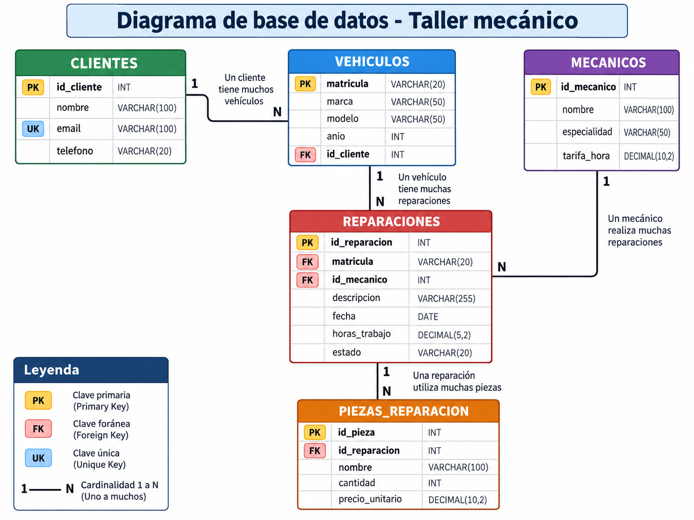

# Taller mecánico — proyecto para el alumnado

## 1. Objetivo del ejercicio

Implementar el acceso a datos de un taller mecánico con **Java 21, JDBC, SQLite y Maven**, utilizando consultas parametrizadas y pruebas automatizadas con JUnit 5.

Al finalizar deberás ser capaz de:

- Interpretar un modelo relacional e identificar claves primarias, únicas y foráneas.
- Escribir consultas SQL con filtros, relaciones y agregaciones.
- Implementar operaciones CRUD mediante el patrón DAO.
- Transformar filas de un `ResultSet` en objetos Java.
- Utilizar `List`, `Optional` y `BigDecimal` correctamente.
- Gestionar conexiones, sentencias, resultados y errores.
- Comprobar el comportamiento de una aplicación mediante pruebas aisladas.
- Reconocer código repetido e implementar una refactorización con una clase abstracta.

**El proyecto contiene los modelos y las firmas de los DAO (definición de las funciones, que están pendientes de implementar).

## 2. Requisitos y puesta en marcha

Necesitas un JDK 21 y Maven disponibles, y un editor o IDE compatible con proyectos Maven. Maven gestiona las dependencias declaradas en `pom.xml`: SQLite JDBC y JUnit Jupiter.

Para limpiar resultados anteriores y repetir la ejecución:

```bash
mvn clean test
```

## 3. Material del proyecto

| Elemento | Contenido y finalidad |
| --- | --- |
| `pom.xml` | Configuración de compilación y dependencias |
| `src/main/java/es/ejemplo/taller/modelo/` | Cinco clases modelo con constructores y métodos de acceso |
| `src/main/java/es/ejemplo/taller/dao/` | Cinco DAO independientes con métodos pendientes |
| `src/main/resources/schema.sql` | Creación de tablas y restricciones |
| `src/test/java/es/ejemplo/taller/` | Preparación de las pruebas y pruebas de los DAO |
| `src/test/resources/taller-test.sqlite3` | Plantilla vacía que se copia para cada prueba |
| `datos/taller.sqlite3` | Base de datos con ejemplos para explorar y consultar |
| `datos/taller-test.sqlite3` | Copia del esquema vacío para trabajo auxiliar |
| `diagrama-taller.png` | Diagrama de la base de datos |

La base de ejemplo contiene 6 clientes, 8 vehículos, 4 mecánicos, 10 reparaciones y 12 piezas. No debes utilizar esos recuentos como condición para validar cualquier base de datos: pertenecen únicamente a los datos de ejemplo de esta entrega.

`target/` es una carpeta generada por Maven. Sus compilados e informes no son código fuente y no deben incluirse en la entrega final.

## 4. Modelo de datos



| Tabla | Clave primaria | Relaciones y restricciones principales |
| --- | --- | --- |
| `clientes` | `id_cliente`, entero autogenerado | Nombre y correo obligatorios; correo único |
| `vehiculos` | `matricula`, texto | Cliente asociado; marca, modelo y año obligatorios |
| `mecanicos` | `id_mecanico`, entero autogenerado | Nombre y especialidad obligatorios; tarifa no negativa |
| `reparaciones` | `id_reparacion`, entero autogenerado | Vehículo y mecánico asociados; horas no negativas; estado limitado |
| `piezas_reparacion` | `id_pieza`, entero autogenerado | Reparación asociada; cantidad positiva; precio no negativo |

> **Autogenerado**, quiere decir que durante la inserción genera el id la bbdd (PRIMARY KEY AUTOINCREMENT). Debes de tenerlo en cuenta a la hora de realizar las operaciones sobre la bbdd.

Relaciones:

- Un cliente puede tener varios vehículos.
- Un vehículo puede tener varias reparaciones.
- Un mecánico puede realizar varias reparaciones.
- Una reparación puede incluir varias piezas.

Los estados admitidos son `PENDIENTE`, `EN_PROCESO` y `FINALIZADA`. El esquema declara `ON DELETE RESTRICT` en las relaciones: su aplicación requiere que esté activada la comprobación de **claves foráneas en la conexión**.

### Tipos de datos y reglas

El diagrama expresa tipos conceptuales como `VARCHAR`, `DATE` y `DECIMAL`. El esquema SQLite entregado utiliza principalmente `TEXT`, `INTEGER` y `NUMERIC`. Consulta `schema.sql` para conocer las restricciones que realmente están declaradas; las longitudes y escalas dibujadas no constituyen validaciones adicionales en ese archivo.

- En los modelos, los identificadores autogenerados se representan mediante `Integer`; la matrícula es `String`.
- Las fechas se manejan como `String`: utiliza el formato `AAAA-MM-DD`. El esquema no valida por sí solo que el texto sea una fecha real; valida el formato y la fecha en el código Java.
- Los importes y las horas se representan con `BigDecimal`. Evita introducir cálculos intermedios con `double`; construye valores decimales a partir de texto cuando proceda.
- `NOT NULL` impide almacenar `NULL`, pero no impide automáticamente guardar `""` o espacios.
- El teléfono del cliente admite `null`.
- Considera inválidos los textos obligatorios vacíos o compuestos solo por espacios. Esta regla debe implementarse expresamente; no está cubierta completamente por las pruebas originales.

## 5. Primera fase: conocer la base de datos con SQL

Antes de programar los DAO, explora `datos/taller.sqlite3` y guarda tus consultas en `consultas.sql`. Añade comentarios que expliquen qué obtiene cada consulta. Realiza cualquier experimento que modifique datos sobre una copia de la base de ejemplo.

Resuelve estas **10 actividades**:

1. Lista los clientes ordenados por nombre.
2. Consulta matrícula, marca, modelo y año de los vehículos de una marca elegida.
3. Obtén los vehículos de un cliente utilizando su identificador.
4. Lista los mecánicos de una especialidad y ordénalos por tarifa.
5. Obtén las reparaciones pendientes, ordenadas por fecha.
6. Muestra la matrícula de cada vehículo y el nombre de su propietario. Resuélvelo una vez con `WHERE` y otra con `INNER JOIN`.
7. Muestra las reparaciones con el nombre del cliente, la matrícula y el nombre del mecánico.
8. Cuenta los vehículos de cada cliente, incluyendo clientes sin vehículos.
9. Calcula el coste de piezas por reparación, incluyendo las reparaciones sin piezas con coste cero.
10. Obtén las reparaciones que no tienen piezas asociadas.

Si los datos de ejemplo no permiten observar un caso, prepara datos adicionales en una copia. Explica la diferencia entre `INNER JOIN` y `LEFT JOIN`, y para qué sirven `GROUP BY`, `SUM` y `COALESCE`.

### Pista: relacionar tablas y proteger sus relaciones son cosas distintas

Puedes relacionar tablas mediante `JOIN ... ON` o mediante una condición en `WHERE` aunque la comprobación de claves foráneas esté desactivada. La relación de la consulta depende de la condición que escribes.

```sql
-- Relación mediante WHERE
SELECT v.matricula, c.nombre
FROM vehiculos v, clientes c
WHERE v.id_cliente = c.id_cliente;
```

```sql
-- Relación mediante INNER JOIN
SELECT v.matricula, c.nombre
FROM vehiculos v
INNER JOIN clientes c ON v.id_cliente = c.id_cliente;
```

Estas dos consultas expresan la misma relación interna. Una clave foránea no añade automáticamente la condición a una consulta ni es un requisito para utilizar `JOIN`.

**Investiga:** si un vehículo hace referencia a un cliente inexistente, ¿aparece en un `INNER JOIN` con clientes? ¿Qué obtendrías con un `LEFT JOIN` desde vehículos hacia clientes?

### Pista: activar la integridad referencial

La instrucción de SQLite empieza así:

```sql
PRAGMA foreign_keys = ...;
```

Sustituye los puntos suspensivos por el valor adecuado: la línea anterior es una pista, no una sentencia lista para ejecutar. Puedes consultar el estado mediante:

```sql
PRAGMA foreign_keys;
```

Esta configuración se aplica a **cada conexión**. Activarla en una herramienta de consulta o en la conexión de preparación de una prueba no configura las conexiones que se abran después, *se ahí que se debe de hacer en un lugar o forma que siempre se active*.

En una copia de la base de datos, compara qué sucede al:

- Insertar un vehículo cuyo cliente no existe.
- Actualizar una reparación para asociarla a un mecánico inexistente.
- Borrar un cliente que tiene vehículos asociados.

**Esta investigación es una actividad de aprendizaje; activar las claves foráneas en todos los DAO no es una condición obligatoria de esta entrega.** Las pruebas obligatorias no deben exigir el rechazo de referencias inválidas ni los borrados restringidos. Si realizas una ampliación específica de integridad, documenta cómo se configura la conexión y separa sus pruebas.

## 6. Segunda fase: implementar los DAO

Existen **33 métodos pendientes**: 25 operaciones CRUD y 8 consultas específicas.

| DAO | Métodos CRUD | Consultas específicas | Total |
| --- | --- | --- | ---: |
| `ClienteDao` | `listar`, `buscarPorId`, `insertar`, `actualizar`, `eliminar` | Ninguna | 5 |
| `MecanicoDao` | Los cinco métodos CRUD | `buscarPorEspecialidad` | 6 |
| `VehiculoDao` | Los cinco métodos CRUD | `buscarPorCliente`, `listarPorMarca` | 7 |
| `ReparacionDao` | Los cinco métodos CRUD | `buscarPorVehiculo`, `buscarPorMecanico`, `listarPendientes` | 8 |
| `PiezaReparacionDao` | Los cinco métodos CRUD | `listarPorReparacion`, `calcularCostePiezas` | 7 |
| **Total** | **25** | **8** | **33** |

Orden recomendado: clientes, mecánicos, vehículos, reparaciones y piezas. Implementa y comprueba cada bloque antes de avanzar.

### Contratos de los métodos

Mantén las firmas públicas (definición de funciones) y los constructores de los DAO para conservar la compatibilidad con las pruebas.

| Operación | Resultado esperado |
| --- | --- |
| `listar` y filtros | Lista de objetos; lista vacía si no hay coincidencias; nunca `null` |
| `buscarPorId` | `Optional` con el objeto si existe; `Optional.empty()` si no existe |
| `insertar` con ID autogenerado | Identificador generado, positivo, si se inserta; `0` si se rechaza o falla |
| `VehiculoDao.insertar` | `1` si se inserta; `0` si se rechaza o falla; la matrícula la aporta el objeto |
| `actualizar` | Número de filas modificadas: normalmente `1`; `0` si no existe o la operación se rechaza o falla |
| `eliminar` | Número de filas eliminadas: normalmente `1`; `0` si no existe o la operación se rechaza o falla |
| `calcularCostePiezas` | Suma de `cantidad × precio_unitario`; `BigDecimal.ZERO` si no hay piezas |

Las búsquedas por marca y especialidad usan coincidencia exacta, sin comodines añadidos ni normalización de mayúsculas. `listarPendientes` selecciona únicamente el estado `PENDIENTE`. Las pruebas no deben depender del orden de una lista salvo que se haya establecido expresamente un `ORDER BY` y un contrato de ordenación.

En los casos límite: un objeto `null` en inserción o actualización devuelve `0`; un identificador `null` o un filtro textual nulo o en blanco devuelve ausencia, lista vacía o `0`, según el tipo de retorno. No interpretes un filtro vacío como una petición de listar toda la tabla.

### Requisitos de implementación

- Utiliza `PreparedStatement` para los valores externos. No concatenes entradas en el SQL.
- Gestiona `Connection`, `PreparedStatement` y `ResultSet` con `try-with-resources`.
- Recupera los identificadores generados; no supongas que serán `1` ni que estarán libres determinados valores.
- Respeta las restricciones de unicidad, nulabilidad y valores numéricos del esquema.
- Gestiona `SQLException` internamente: no añadas `throws SQLException` a la API pública de los DAO.
- Controla las entradas inválidas y las excepciones de ejecución previsibles. No utilices un `catch (RuntimeException)` indiscriminado para ocultar errores de programación.
- Ante errores de acceso, proporciona un diagnóstico útil sin mostrar datos personales innecesarios. En esta práctica se conservan los retornos de respaldo indicados; explica que pueden confundir un fallo de consulta con la ausencia de resultados.
- No uses los datos de ejemplo como resultados fijos ni adaptes el código a los valores concretos de las pruebas.

## 7. Tercera fase: centralizar el acceso a la base de datos

Implementa `es.ejemplo.taller.infra.ConexionBD` después de comprender cómo funciona el acceso desde los primeros DAO. Se entrega únicamente su firma `public static Connection abrir(String url) throws SQLException`, con una excepción provisional, para que las 90 pruebas compilen desde el inicio. No se entrega su solución. Al finalizar, todos los DAO deben utilizar este punto común de apertura. Esta clase de infraestructura puede lanzar `SQLException`; son los métodos públicos de los DAO los que deben gestionarla internamente. **No obstante**, *para tu implementación*, puedes crear otro constructor de la clase **ConexionBD**.y hacer los cambios que estimes.

### Un único punto de acceso y configuración

Centralizar la creación de conexiones permite:

- Evitar repetir rutas, construcción de URL y configuración.
- Comprobar la existencia del archivo de forma uniforme.
- Mantener un tratamiento coherente de los errores.
- Cambiar de base de trabajo a base temporal de pruebas sin modificar los DAO.
- Aplicar configuraciones comunes, si se decide utilizarlas.

Aquí «conexión única» significa **una única clase responsable de crear y configurar las conexiones**, no una conexión global abierta permanentemente. Cada operación puede abrir su conexión y cerrarla con `try-with-resources`. Una conexión estática asociada a una ruta fija dificultaría el aislamiento de las pruebas.

### Comprobar el archivo antes de conectar

SQLite puede crear una base vacía al conectarse a una ruta inexistente. Por ello, abrir una conexión sin error no demuestra que se haya localizado la base esperada. **Controla esta a través de un constructor común** tal y como hemos trabajado en clase.

La clase debe:

1. Mantener `ConexionBD.abrir(String url) throws SQLException` para que las pruebas compilen. Recibe una URL `jdbc:sqlite:` con una ruta de archivo, incluida la URL temporal que recibe cada DAO. Para este ejercicio no es necesario admitir bases en memoria ni URL URI.
2. Comprobar, **antes de llamar a JDBC**, que la ruta corresponde a un archivo regular, existente y legible.
3. Si falta, informar del problema y no crear silenciosamente otro archivo ni directorios.
4. Si existe, intentar conectar y gestionar el posible error de acceso.
5. Permitir comprobar que la base contiene las cinco tablas esperadas. Un archivo existente no garantiza que sea una base SQLite válida ni que tenga el esquema correcto.

**Pista:** investiga `Path`, `Files.exists`, `Files.isRegularFile` y `Files.isReadable`. Evita depender de rutas absolutas de tu equipo. El control de existencia de este ejercicio se plantea para bases SQLite almacenadas en archivos.

## 8. Cuarta fase: implementar una refactorización con clase abstracta

**Los DAO iniciales son independientes: no incluyen `AbstractDao`, ni deben incorporar un `extends` hacia una clase inexistente.** Primero consigue una implementación funcional; después estudia la refactorización.

Una clase abstracta puede contener estado y métodos ya implementados, junto con operaciones abstractas que deben completar las subclases. No puede instanciarse directamente.

### Ventajas en este proyecto

- Reducir la repetición de mecanismos de acceso y tratamiento común de resultados o errores.
- Mantener un criterio uniforme en operaciones compartidas.
- Corregir un comportamiento común en un único lugar.
- Separar los pasos generales de las consultas y del mapeo específico de cada tabla.
- Utilizar genéricos para expresar tipos con más seguridad.

No todo debe ir a la clase base: el SQL, los parámetros y la conversión de filas pueden variar entre entidades. Evita una abstracción que necesite numerosas excepciones para cada DAO.

**Pistas de diseño:** ¿qué partes se repiten realmente? ¿Qué responsabilidad corresponde a `ConexionBD` y cuál al DAO? ¿Cómo representarías tanto una clave `Integer` como una matrícula `String`? Una posible dirección es `AbstractDao<T, ID>`; debes justificar tu diseño antes de implementarlo.

La refactorización con clase abstracta forma parte de la entrega evaluable. Debes crearla tú: no se entrega ningún archivo `AbstractDao.java` ni un `extends` provisional. Una vez creadas y probadas las operaciones básicas, diseña la abstracción e integra los cinco DAO, manteniendo sus constructores y firmas públicas. La clase base debe reutilizar comportamiento real; declararla sin uso o crear una clase vacía no cumple este objetivo. Las pruebas funcionales no inspeccionan la jerarquía: este criterio se revisa mediante el código y tu explicación.

## 9. Pruebas: cuántas hay que superar

### Suite entregada: 90 pruebas obligatorias

Este proyecto ya incluye **90 métodos `@Test` ejecutables**, sin necesidad de escribirlos ni habilitarlos para comenzar. 

| Clase | Número de pruebas |
| --- | ---: |
| `ClienteDaoTest` | 10 |
| `MecanicoDaoTest` | 10 |
| `VehiculoDaoTest` | 10 |
| `ReparacionDaoTest` | 10 |
| `PiezaReparacionDaoTest` | 10 |
| `Test sobre dao´s específicos` | 40 |
| **Total** | **90** |

**Objetivo final: 90 pruebas ejecutadas, 0 fallos, 0 errores y 0 omitidas.** La clase abstracta se evalúa además mediante revisión del diseño: pasar los tests no demuestra por sí solo que la hayas implementado.

El proyecto inicial compila (incluidas las clases de prueba), pero los DAO devuelven resultados provisionales y `ConexionBD.abrir` lanza una excepción de tarea pendiente. Es normal encontrar fallos y errores al ejecutar la suite inicial. Algunos casos negativos pasan incluso antes de implementar sus métodos: eso no acredita que estén resueltos.

`BaseTest` prepara una copia temporal vacía por prueba y utiliza JDBC directamente para el montaje, por lo que no necesita una `ConexionBD` resuelta. Los dos casos de archivo y plantilla válidos requieren implementar `ConexionBD`; no se espera que pasen inicialmente. No modifiques la base de trabajo para satisfacer las pruebas. Los informes se generan en `target/surefire-reports/`.

| Bloque adicional | Pruebas |
| --- | ---: |
| Archivo, esquema y conexión | 6 |
| Entradas y resultados vacíos | 10 |
| Actualizaciones persistidas | 5 |
| Borrados persistidos | 5 |
| Filtros con múltiples registros | 7 |
| Coste de piezas | 4 |
| Identificadores y aislamiento | 3 |
| **Total adicional ya incluido** | **40** |

### Cómo interpretar y completar las pruebas

- Los 90 casos ya son pruebas independientes. Si añades pruebas propias, identifica su finalidad y distingue el nuevo total de las 90 entregadas.
- Conserva los archivos entregados. Los casos de conexión positiva pasarán cuando implementes `ConexionBD`.
- Usa nombres descriptivos en lugar de `caso01`.
- Captura los IDs devueltos. No supongas que el primer registro tiene identificador `1`.
- Los filtros deben comprobar las identidades exactas de los resultados, no solo su cantidad. Prepara varios registros coincidentes y otros que deban quedar fuera.
- En actualizaciones, consulta de nuevo y comprueba el estado almacenado, además del retorno.
- En borrados, consulta después y verifica que otros registros siguen presentes. Utiliza registros sin dependencias para estos casos obligatorios.
- Para costes, compara `BigDecimal` numéricamente mediante `compareTo`: la escala no debe provocar falsos fallos.
- Ejemplo de cálculo: dos unidades de `10.25` y tres de `0.10` deben sumar `20.80`.
- La prueba de inserción de vehículos ya consulta su existencia tras insertarlo; el ayudante también comprueba la inserción.

Las pruebas de claves foráneas inválidas y borrados restringidos quedan **fuera de esos 90 casos**. Pueden añadirse como ampliación opcional con integridad activada y configuración explícita; no deben exigir esa configuración a la implementación básica.

## 10. Entrega del alumnado

Entrega:

- Código fuente de los DAO implementados.
- `consultas.sql` con las 10 actividades y comentarios.
- Las 90 pruebas entregadas, conservadas sin eliminar ni desactivar; si añades casos propios, identifica su número y su finalidad.
- Una memoria breve, en un archivo propio distinto de este README, con decisiones sobre errores, comprobación de archivos y resultados de la investigación de integridad referencial.
- `ConexionBD`, tu clase abstracta y los cinco DAO refactorizados, junto con una justificación del reparto de responsabilidades.
- Resultado final de `mvn clean test`, identificando qué suite has ejecutado.

No entregues `target/`, rutas personales, bases temporales ni una solución que sustituya las pruebas por resultados prefijados. Conserva las bases originales para que la práctica se pueda reproducir.

## 11. Rúbrica de evaluación — 100 puntos

La evaluación combina pruebas, revisión del código, consultas y explicación. La clase abstracta es un objetivo evaluable de la entrega final, aunque no sea necesaria para empezar a trabajar.

| Criterio | Máximo | Logro completo | Logro parcial | Insuficiente |
| --- | ---: | --- | --- | --- |
| Funcionalidad y contratos de los 33 métodos DAO | 25 | CRUD, filtros, retornos, IDs y costes correctos; se comprueba persistencia | Parte funcional, con errores localizados o contratos incompletos | Métodos pendientes, resultados prefijados o errores generalizados |
| Clase abstracta y refactorización de los cinco DAO | 20 | Clase creada por el alumno, usada por los cinco DAO, con comportamiento común real; resuelve las claves Integer y String con tipos adecuados y mantiene la API | Abstracción útil pero integrada solo en algunos DAO, o con duplicación o diseño de tipos mejorable | No existe, está vacía, no se utiliza o solo añade herencia sin reutilización |
| ConexionBD y comprobación de la BBDD | 15 | Apertura centralizada utilizada por todos los DAO; verifica archivo antes de conectar, comprueba las cinco tablas, gestiona fallos y conserva el aislamiento | Centralización o comprobaciones incompletas; algún DAO abre conexiones por separado | No comprueba existencia, crea otra base por error o utiliza una conexión global que mezcla las pruebas |
| JDBC, recursos, validación y errores | 15 | PreparedStatement con valores externos, try-with-resources, entradas inválidas controladas y diagnóstico útil sin ocultar errores de programación | Aplicación irregular de los criterios o validaciones incompletas | Concatenación de valores, fugas de recursos o errores silenciados indiscriminadamente |
| Pruebas y comprensión de sus resultados | 10 | Las 90 pasan sin alterarlas; explica preparación, retorno, estado e independencia de casos | Suite conservada con fallos pendientes; explica solo parte de los casos | Omite o desactiva pruebas, cambia expectativas para ocultar fallos o no puede explicar los resultados |
| Diez actividades SQL y modelo relacional | 10 | Consultas correctas, incluyen casos sin coincidencias donde procede y explicación de JOIN, WHERE y agregaciones | Consultas o explicaciones parcialmente correctas | Consultas ausentes o no comprenden las relaciones |
| Claridad y memoria técnica | 5 | Código legible, decisiones justificadas, investigación de integridad y entrega reproducible sin target | Documentación o presentación incompleta | Falta de explicación o entrega difícil de reproducir |
| **Total** | **100** | | | |

Para puntuar cada criterio se utiliza el nivel de logro: **completo = 100 % de sus puntos; parcial alto = 75 %; parcial básico = 50 %; insuficiente con evidencias mínimas = 25 %; ausente o no demostrable = 0 %**. La revisión debe indicar las evidencias que justifican cada nivel. La nota sobre 10 se obtiene dividiendo los puntos entre 10.

La integridad referencial activada no aporta ni resta puntos por sí sola: se valora que expliques su efecto y su independencia respecto a JOIN. No se exige que los DAO la activen. La ausencia de clase abstracta implica 0 puntos en ese criterio, aunque las 90 pruebas pasen.

## 12. Lista de comprobación antes de entregar

- [ ] He resuelto las 10 actividades en `consultas.sql`.
- [ ] Los 33 métodos DAO cumplen sus contratos.
- [ ] Los cinco DAO utilizan `ConexionBD` para abrir conexiones.
- [ ] La clase de conexión comprueba el archivo antes de intentar abrirlo y verifica las tablas.
- [ ] He creado una clase abstracta, integrada con los cinco DAO, que reutiliza código real.
- [ ] He conservado los constructores y las firmas que utilizan las pruebas.
- [ ] Pasan las 90 pruebas entregadas, sin omitirlas ni cambiar sus expectativas.
- [ ] Puedo explicar los resultados esperados de los casos del siguiente catálogo.
- [ ] La memoria explica mi diseño y la investigación sobre claves foráneas.
- [ ] El ZIP final no incluye `target/` ni archivos temporales.

## 13. Catálogo individual: preparación, operación y resultado esperado


Las 50 pruebas de partida conservan sus nombres para facilitar la comparación. Cada caso es un `@Test` independiente.

`BaseTest` prepara para cada prueba una copia temporal vacía. Los ayudantes insertan las dependencias necesarias: `cliente()` crea Ana; `mecanico()` crea Luis; `vehiculo()` crea propietario y Seat 1234ABC; `reparacion()` añade mecánico y revisión pendiente; `pieza()` añade dos filtros a 10.00. Los IDs se recuperan de las inserciones o de los objetos consultados.

| Prueba | Preparación y operación (Java ejecutado) | Resultado esperado |
| --- | --- | --- |
| `ClienteDaoTest.caso01` | `assertTrue(cliente()>0);` | Insertar Ana devuelve un ID positivo |
| `ClienteDaoTest.caso02` | `int id=cliente(); assertEquals("Ana",clientes.buscarPorId(id).orElseThrow().getNombre());` | Buscar el ID insertado devuelve nombre Ana |
| `ClienteDaoTest.caso03` | `assertTrue(clientes.buscarPorId(999).isEmpty());` | Buscar 999 devuelve Optional.empty |
| `ClienteDaoTest.caso04` | `cliente(); assertEquals(1,clientes.listar().size());` | Listar tras una inserción devuelve una lista de tamaño 1 |
| `ClienteDaoTest.caso05` | `int id=cliente(); assertEquals(1,clientes.actualizar(new Cliente(id,"Eva","eva@example.com","666")));` | Actualizar Ana por Eva devuelve 1 |
| `ClienteDaoTest.caso06` | `int id=cliente(); clientes.actualizar(new Cliente(id,"Eva","eva@example.com","666")); assertEquals("Eva",clientes.buscarPorId(id).orElseThrow().getNombre());` | Consultar después de actualizar devuelve nombre Eva |
| `ClienteDaoTest.caso07` | `int id=cliente(); assertEquals(1,clientes.eliminar(id));` | Eliminar el ID existente devuelve 1 |
| `ClienteDaoTest.caso08` | `assertEquals(0,clientes.eliminar(999));` | Eliminar 999 devuelve 0 |
| `ClienteDaoTest.caso09` | `cliente(); assertEquals(0,clientes.insertar(new Cliente(null,"Luis","ana@example.com","666")));` | Insertar correo duplicado devuelve 0 |
| `ClienteDaoTest.caso10` | `assertEquals(0,clientes.insertar(null));` | Insertar null devuelve 0 |
| `MecanicoDaoTest.caso01` | `assertTrue(mecanico()>0);` | Insertar Luis devuelve un ID positivo |
| `MecanicoDaoTest.caso02` | `int id=mecanico(); assertTrue(mecanicos.buscarPorId(id).isPresent());` | Buscar el ID insertado devuelve un Optional presente |
| `MecanicoDaoTest.caso03` | `assertTrue(mecanicos.buscarPorId(999).isEmpty());` | Buscar 999 devuelve Optional.empty |
| `MecanicoDaoTest.caso04` | `mecanico(); assertEquals(1,mecanicos.listar().size());` | Listar tras una inserción devuelve tamaño 1 |
| `MecanicoDaoTest.caso05` | `mecanico(); assertEquals(1,mecanicos.buscarPorEspecialidad("Motor").size());` | Filtrar Motor devuelve tamaño 1 |
| `MecanicoDaoTest.caso06` | `mecanico(); assertEquals(0,mecanicos.buscarPorEspecialidad("Chapa").size());` | Filtrar Chapa sin coincidencias devuelve tamaño 0 |
| `MecanicoDaoTest.caso07` | `int id=mecanico(); assertEquals(1,mecanicos.actualizar(new Mecanico(id,"Luis","Chapa",new BigDecimal("50"))));` | Actualizar especialidad y tarifa devuelve 1 |
| `MecanicoDaoTest.caso08` | `int id=mecanico(); assertEquals(1,mecanicos.eliminar(id));` | Eliminar el mecánico devuelve 1 |
| `MecanicoDaoTest.caso09` | `assertEquals(0,mecanicos.insertar(new Mecanico(null,"Eva","Chapa",new BigDecimal("-1"))));` | Insertar tarifa -1 devuelve 0 |
| `MecanicoDaoTest.caso10` | `assertEquals(0,mecanicos.actualizar(null));` | Actualizar null devuelve 0 |
| `VehiculoDaoTest.caso01` | `String m=vehiculo(); assertEquals("1234ABC",m); assertTrue(vehiculos.buscarPorId(m).isPresent());` | Insertar 1234ABC permite recuperarlo y conserva la matrícula |
| `VehiculoDaoTest.caso02` | `String m=vehiculo(); assertTrue(vehiculos.buscarPorId(m).isPresent());` | Buscar matrícula insertada devuelve Optional presente |
| `VehiculoDaoTest.caso03` | `assertTrue(vehiculos.buscarPorId("NO").isEmpty());` | Buscar NO devuelve Optional.empty |
| `VehiculoDaoTest.caso04` | `vehiculo(); assertEquals(1,vehiculos.listar().size());` | Listar tras insertar devuelve tamaño 1 |
| `VehiculoDaoTest.caso05` | `String m=vehiculo(); int id=vehiculos.buscarPorId(m).orElseThrow().getIdCliente(); assertEquals(1,vehiculos.buscarPorCliente(id).size());` | Buscar por propietario obtenido devuelve tamaño 1 |
| `VehiculoDaoTest.caso06` | `vehiculo(); assertEquals(0,vehiculos.buscarPorCliente(99).size());` | Buscar propietario 99 devuelve tamaño 0 |
| `VehiculoDaoTest.caso07` | `vehiculo(); assertEquals(1,vehiculos.listarPorMarca("Seat").size());` | Filtrar Seat devuelve tamaño 1 |
| `VehiculoDaoTest.caso08` | `String m=vehiculo(); int id=vehiculos.buscarPorId(m).orElseThrow().getIdCliente(); assertEquals(1,vehiculos.actualizar(new Vehiculo(m,"Ford","Focus",2020,id)));` | Actualizar vehículo existente devuelve 1 |
| `VehiculoDaoTest.caso09` | `String m=vehiculo(); assertEquals(1,vehiculos.eliminar(m));` | Eliminar vehículo existente devuelve 1 |
| `VehiculoDaoTest.caso10` | `String m=vehiculo(); int id=vehiculos.buscarPorId(m).orElseThrow().getIdCliente(); assertEquals(0,vehiculos.insertar(new Vehiculo(m,"Seat","Ibiza",2018,id)));` | Insertar matrícula duplicada devuelve 0 |
| `ReparacionDaoTest.caso01` | `assertTrue(reparacion()>0);` | Insertar reparación devuelve ID positivo |
| `ReparacionDaoTest.caso02` | `int id=reparacion(); assertTrue(reparaciones.buscarPorId(id).isPresent());` | Buscar ID insertado devuelve Optional presente |
| `ReparacionDaoTest.caso03` | `assertTrue(reparaciones.buscarPorId(999).isEmpty());` | Buscar 999 devuelve Optional.empty |
| `ReparacionDaoTest.caso04` | `reparacion(); assertEquals(1,reparaciones.listar().size());` | Listar tras insertar devuelve tamaño 1 |
| `ReparacionDaoTest.caso05` | `reparacion(); assertEquals(1,reparaciones.buscarPorVehiculo("1234ABC").size());` | Buscar por 1234ABC devuelve tamaño 1 |
| `ReparacionDaoTest.caso06` | `int id=reparacion(); int mec=reparaciones.buscarPorId(id).orElseThrow().getIdMecanico(); assertEquals(1,reparaciones.buscarPorMecanico(mec).size());` | Buscar por mecánico obtenido devuelve tamaño 1 |
| `ReparacionDaoTest.caso07` | `reparacion(); assertEquals(1,reparaciones.listarPendientes().size());` | Listar pendientes devuelve tamaño 1 |
| `ReparacionDaoTest.caso08` | `int id=reparacion(); int mec=reparaciones.buscarPorId(id).orElseThrow().getIdMecanico(); assertEquals(1,reparaciones.actualizar(new Reparacion(id,"1234ABC",mec,"Ok","2026-01-11",new BigDecimal("3"),"FINALIZADA")));` | Actualizar reparación existente devuelve 1 |
| `ReparacionDaoTest.caso09` | `int id=reparacion(); assertEquals(1,reparaciones.eliminar(id));` | Eliminar reparación existente devuelve 1 |
| `ReparacionDaoTest.caso10` | `String m=vehiculo(); int mec=mecanico(); assertEquals(0,reparaciones.insertar(new Reparacion(null,m,mec,"Error","2026-01-10",new BigDecimal("2"),"INVALIDA")));` | Insertar estado INVALIDA devuelve 0 |
| `PiezaReparacionDaoTest.caso01` | `assertTrue(pieza()>0);` | Insertar pieza devuelve ID positivo |
| `PiezaReparacionDaoTest.caso02` | `int id=pieza(); assertTrue(piezas.buscarPorId(id).isPresent());` | Buscar ID insertado devuelve Optional presente |
| `PiezaReparacionDaoTest.caso03` | `assertTrue(piezas.buscarPorId(999).isEmpty());` | Buscar 999 devuelve Optional.empty |
| `PiezaReparacionDaoTest.caso04` | `pieza(); assertEquals(1,piezas.listar().size());` | Listar tras insertar devuelve tamaño 1 |
| `PiezaReparacionDaoTest.caso05` | `int id=pieza(); int rep=piezas.buscarPorId(id).orElseThrow().getIdReparacion(); assertEquals(1,piezas.listarPorReparacion(rep).size());` | Filtrar por reparación obtenida devuelve tamaño 1 |
| `PiezaReparacionDaoTest.caso06` | `int id=pieza(); int rep=piezas.buscarPorId(id).orElseThrow().getIdReparacion(); assertEquals(0,piezas.calcularCostePiezas(rep).compareTo(new BigDecimal("20")));` | Coste de dos filtros a 10.00 devuelve 20.00 |
| `PiezaReparacionDaoTest.caso07` | `int id=pieza(); int rep=piezas.buscarPorId(id).orElseThrow().getIdReparacion(); assertEquals(1,piezas.actualizar(new PiezaReparacion(id,rep,"Filtro",3,new BigDecimal("15"))));` | Actualizar pieza existente devuelve 1 |
| `PiezaReparacionDaoTest.caso08` | `int id=pieza(); assertEquals(1,piezas.eliminar(id));` | Eliminar pieza existente devuelve 1 |
| `PiezaReparacionDaoTest.caso09` | `int rep=reparacion(); assertEquals(0,piezas.insertar(new PiezaReparacion(null,rep,"F",0,new BigDecimal("10"))));` | Insertar cantidad 0 devuelve 0 |
| `PiezaReparacionDaoTest.caso10` | `assertEquals(0,piezas.insertar(null));` | Insertar null devuelve 0 |
| `AmpliacionTest.archivoTrabajoValido` | Base de ejemplo entregada | Abrir con ConexionBD | Conexión abierta y cinco tablas presentes |
| `AmpliacionTest.plantillaVaciaValida` | Plantilla original | Abrir y contar las cinco tablas | Conexión abierta; 0 filas en cada tabla |
| `AmpliacionTest.rutaInexistenteNoCreaArchivo` | Ruta sin archivo dentro de directorio temporal | Intentar abrir | SQLException y el archivo sigue sin existir |
| `AmpliacionTest.directorioNoEsBase` | Directorio temporal | Intentar abrir como BBDD | SQLException; sigue siendo directorio |
| `AmpliacionTest.archivoNoSqlite` | Archivo con texto ordinario | Intentar abrir | SQLException; no se acepta como BBDD |
| `AmpliacionTest.baseSinTablas` | BBDD SQLite con una tabla ajena | Intentar abrir | SQLException por esquema incompleto |
| `AmpliacionTest.listarClientesVacios` | Plantilla vacía | listar | Lista no nula de tamaño 0 |
| `AmpliacionTest.listarMecanicosVacios` | Plantilla vacía | listar | Lista no nula de tamaño 0 |
| `AmpliacionTest.listarVehiculosVacios` | Plantilla vacía | listar | Lista no nula de tamaño 0 |
| `AmpliacionTest.listarReparacionesVacios` | Plantilla vacía | listar | Lista no nula de tamaño 0 |
| `AmpliacionTest.listarPiezasVacios` | Plantilla vacía | listar | Lista no nula de tamaño 0 |
| `AmpliacionTest.nombreClienteBlanco` | Cliente con nombre de espacios | insertar | 0; no se guarda cliente |
| `AmpliacionTest.especialidadMecanicoBlanca` | Mecánico con especialidad en blanco | insertar | 0; no se guarda mecánico |
| `AmpliacionTest.matriculaVacia` | Cliente existente y matrícula vacía | insertar vehículo | 0; no se guarda vehículo |
| `AmpliacionTest.reparacionNula` | Base vacía | insertar null | 0; no se guarda reparación |
| `AmpliacionTest.marcaNula` | Un vehículo existente | listarPorMarca(null) | Lista no nula de tamaño 0 |
| `AmpliacionTest.actualizarClientePersiste` | Cliente Ana existente | Modificar nombre, email y teléfono; recuperar | 1; Eva, eva@ejemplo.com y 777 |
| `AmpliacionTest.actualizarMecanicoPersiste` | Mecánico existente | Modificar nombre, especialidad y tarifa; recuperar | 1; Eva, Chapa y 50.25 |
| `AmpliacionTest.actualizarVehiculoPersiste` | Vehículo y un segundo propietario | Modificar marca, modelo, año y propietario; recuperar | 1; Ford, Focus, 2020 y el nuevo propietario |
| `AmpliacionTest.actualizarReparacionPersiste` | Reparación; segundo vehículo y mecánico | Modificar todos los campos no clave; recuperar | 1; nuevos vínculos, descripción, fecha, horas y estado |
| `AmpliacionTest.actualizarPiezaPersiste` | Pieza y segunda reparación | Modificar reparación, nombre, cantidad y precio; recuperar | 1; nueva reparación, Aceite, 3 y 15.25 |
| `AmpliacionTest.borrarClientePersiste` | Dos clientes sin dependencias | Borrar el primero y consultar ambos | 1; primero ausente y segundo presente |
| `AmpliacionTest.borrarMecanicoPersiste` | Dos mecánicos sin reparaciones | Borrar el primero y consultar ambos | 1; primero ausente y segundo presente |
| `AmpliacionTest.borrarVehiculoPersiste` | Dos vehículos sin reparaciones | Borrar el primero y consultar ambos | 1; primero ausente y segundo presente |
| `AmpliacionTest.borrarReparacionPersiste` | Dos reparaciones sin piezas | Borrar la primera y consultar ambas | 1; primera ausente y segunda presente |
| `AmpliacionTest.borrarPiezaPersiste` | Dos piezas | Borrar la primera y consultar ambas | 1; primera ausente y segunda presente |
| `AmpliacionTest.filtrarEspecialidadMultiples` | Dos Motor y un Chapa | buscarPorEspecialidad Motor | Exactamente los dos IDs de Motor |
| `AmpliacionTest.filtrarPropietarioMultiples` | Dos vehículos de A y uno de B | buscarPorCliente A | Exactamente las matrículas A1 y A2 |
| `AmpliacionTest.filtrarMarcaMultiples` | Dos Seat y un Ford | listarPorMarca Seat | Exactamente A1 y A2 |
| `AmpliacionTest.filtrarReparacionesVehiculoMultiples` | Dos reparaciones de A y una de B | buscarPorVehiculo A | Exactamente las dos reparaciones de A |
| `AmpliacionTest.filtrarReparacionesMecanicoMultiples` | Dos reparaciones de A y una de B | buscarPorMecanico A | Exactamente las dos reparaciones de A |
| `AmpliacionTest.filtrarPendientesMultiples` | Dos pendientes, una en proceso y otra finalizada | listarPendientes | Exactamente los dos IDs pendientes |
| `AmpliacionTest.filtrarPiezasMultiples` | Dos piezas de A y una de B | listarPorReparacion A | Exactamente los dos IDs de piezas de A |
| `AmpliacionTest.costeVariasPiezas` | Piezas: 2 × 10 y 3 × 5 | calcularCostePiezas | 35 |
| `AmpliacionTest.costeDecimal` | Piezas: 2 × 10.25 y 3 × 0.10 | calcularCostePiezas | 20.80, comparación numérica |
| `AmpliacionTest.costeSinPiezas` | Reparación sin piezas | calcularCostePiezas | 0, no null |
| `AmpliacionTest.costeExcluyeOtraReparacion` | Reparación A con coste 6 y B con coste 100 | calcularCostePiezas A | 6; excluye los 100 de B |
| `AmpliacionTest.idsGeneradosDistintos` | Dos clientes con correos diferentes | Insertar y recuperar ambos IDs | IDs positivos distintos y datos correspondientes |
| `AmpliacionTest.relacionConIdNoUno` | Cliente previo y segundo cliente | Asociar vehículo al segundo cliente | Inserción 1 y propietario igual al ID obtenido, distinto de 1 |
| `AmpliacionTest.basesTemporalesIndependientes` | Dos copias de plantilla | Insertar en primera y consultar ambas | Primera con 1 cliente; segunda con 0 |

### Interpretación

Resultado exigido: **90 ejecutadas, 0 fallos, 0 errores y 0 omitidas**. Las nuevas pruebas de modificación vuelven a consultar la BBDD para comprobar la persistencia. Los filtros comprueban tanto el tamaño como el conjunto exacto de identificadores. Los importes se comparan con `compareTo`, sin exigir una escala concreta.

Los casos de referencias inexistentes y borrado restringido pertenecen a la investigación opcional de integridad y no se contabilizan ni se ejecutan en la suite obligatoria. El contrato de un fallo de apertura de `ConexionBD` es lanzar `SQLException`; los DAO la gestionan y devuelven su valor de respaldo.
